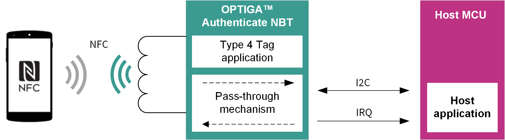

<!--
SPDX-FileCopyrightText: Copyright (c) 2024-2026 Infineon Technologies AG
SPDX-License-Identifier: CC-BY-4.0
-->

# OPTIGA™ Authenticate NBT PT Application for Android

[](CODE_OF_CONDUCT.md)
[](https://github.com/Infineon/optiga-nbt-example-pt-android/actions/workflows/reuse-lint.yml)
[](https://github.com/Infineon/optiga-nbt-example-pt-android/actions/workflows/android-build.yml)

This is the *NBT Pass-Through* mobile phone app, a Java-based *Android Studio* project which showcases the [OPTIGA™ Authenticate NBT](https://www.infineon.com/part/optiga-authenticate-nbt) in the *host parameterization via pass-through (PT)* use case.

## Overview

The example application enables an Android mobile phone to perform synchronous NFC communication with a host device holding an embedded OPTIGA™ Authenticate NBT.
The main purpose of this implementation is to showcase the OPTIGA™ Authenticate NBT's *PT mode* and to provide a simple example on how to use the [OPTIGA™ Authenticate NBT Host Library for Java](https://github.com/infineon/optiga-nbt-lib-java) in Android applications.

Refer to the [OPTIGA™ Authenticate NBT: Host software overview](https://github.com/Infineon/optiga-nbt) repository for an overview of the available host software for the OPTIGA™ Authenticate NBT.



### Features

- Android application with user interface and NFC communication capability
- Example implementation of the OPTIGA™ Authenticate NBT's PT mode functionality
- Synchronous NFC communication  with a host via the OPTIGA™ Authenticate NBT
- Sample usage of the [OPTIGA™ Authenticate NBT Host Library for Java](https://github.com/Infineon/optiga-nbt-lib-java) (ref v1.1.3)

### Documentation

Dedicated documentation for the whole host software offering of the OPTIGA™ Authenticate NBT is available on [GitHub.io](https://infineon.github.io/optiga-nbt).
The online documentation includes an own section to the [PT examples](https://infineon.github.io/optiga-nbt/3400_uc-pt.html) which contains a subpage for this [Android app](https://infineon.github.io/optiga-nbt/projects/optiga-nbt-example-pt-android/index.html).

## Getting started

For information on how to setup and use this example, refer to the [host software documentation](https://infineon.github.io/optiga-nbt/projects/optiga-nbt-example-pt-android/index.html).

### Requirements

- NFC-enabled Android device running on API level 30 or higher (Android 11+)
  - *Developer options* have to be enabled (see [Android Studio IDE guides](https://developer.android.com/studio/debug/dev-options) for more information).
- Android Studio (tested with Android Studio Rabbit 2 | 2026.2.2)

### Setup

This project is intended to be built and installed using *Android Studio*.

The project uses a Git submodule (the OPTIGA™ Authenticate NBT Host Library for Java), so downloading a ZIP archive of the repository is not sufficient. Clone the repository together with its submodule:

```sh
git clone --recurse-submodules <repository-url>
```

If the repository is already cloned, initialize the submodule with:

```sh
git submodule update --init --recursive
```

Then import the project into *Android Studio* (by selecting File --> Open).

For installing the Android application to the target mobile phone, it is recommended to either use *Android Studio* itself or to transfer and install the `.apk` file manually to the mobile phone.

### Usage

After installation, the Android app can be started and used to evaluate the OPTIGA™ Authenticate NBT's PT functionality. See [host software documentation](https://infineon.github.io/optiga-nbt/projects/optiga-nbt-example-pt-android/index.html) for more information.

To make sure the mobile phone app works as intended, NFC needs to be enabled on the Android device. Additionally, the app's permissions must be set correctly.

## Additional information

This section lists additional resources and information related to this repository.

### Contact

In case of questions regarding this repository and its contents, refer to [MAINTAINERS.md](MAINTAINERS.md) for the contact details of this project's maintainers.

### Contributing

Please read [CONTRIBUTING.md](CONTRIBUTING.md) for detailed contribution instructions and refer to our [CODE_OF_CONDUCT.md](CODE_OF_CONDUCT.md).

### Licensing

Please see our [LICENSE](LICENSE) for copyright and license information.

This project follows the [REUSE](https://reuse.software/) approach, so copyright and licensing
information is available for every file (including third party components) either in the file
header, an individual *.license file or a REUSE.toml file. All licenses can be found in the
[LICENSES](LICENSES) folder.

### Related resources

- [OPTIGA™ Authenticate NBT: Host software overview](https://github.com/Infineon/optiga-nbt)
- [OPTIGA™ Authenticate NBT: Host software documentation](https://infineon.github.io/optiga-nbt)
  - [*NBT Pass-Through* app](https://infineon.github.io/optiga-nbt/projects/optiga-nbt-example-pt-android/index.html)
- [OPTIGA™ Authenticate NBT: Product page](https://www.infineon.com/part/optiga-authenticate-nbt)
